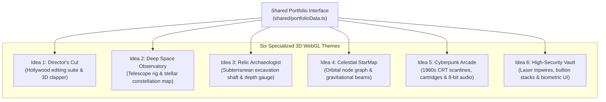

# 3D WebGL Portfolio Theme Exploration Suite

> **Source Repository:** [github.com/Pradeep-B28/Portfolio](https://github.com/Pradeep-B28/Portfolio)  
> **Live Production Portfolio:** [pradeep-b28.github.io/Pradeep-B28](https://pradeep-b28.github.io/Pradeep-B28/)  
> **Author:** [B Pradeep](https://github.com/Pradeep-B28) · [Portfolio](https://pradeep-b28.github.io/Pradeep-B28/)

---

## Overview

A modular exploration suite of **6 interactive 3D WebGL developer portfolio themes**, engineered with React 18, Three.js, Vite, and TypeScript. Each theme explores a distinct creative art direction—ranging from cinematic physical sets to cosmic radar projections and CRT arcade simulations—all fed by a unified, decoupled TypeScript data model.



---

## Theme Showcase Matrix

| Theme | Directory | Visual Concept & 3D Environment | Key Interactive Components | Stack |
| :--- | :--- | :--- | :--- | :--- |
| **Director's Cut** | [`Idea 1/`](Idea%201/) | Hollywood editing suite with 3D clapper slate, camera rig, and film reels | `FilmSlate3D`, `TimelineScrubber`, `DirectorsCutModal` | React 18, Three.js, Vite, TS |
| **Deep Space Observatory** | [`Idea 2/`](Idea%202/) | Deep-space observatory telescope scanning planetary bodies and nebulae | `ObservatoryCanvas`, `ConstellationOverlay`, `SignalSweepBar` | React 18, Three.js, Vite, Tailwind |
| **Relic Archaeologist** | [`Idea 3/`](Idea%203/) | Subterranean excavation dig shaft with geological stratigraphy and relics | `DigShaft3D`, `RelicInspectorModal`, `DepthGauge` | React 18, Three.js, Vite, TS |
| **Celestial StarMap** | [`Idea 4/`](Idea%204/) | Cosmic orbital network with glowing interactive skill nodes and light beams | `StarMap3D`, `SkillsConstellationGraph`, `CosmicRadarScanner` | React 18, Three.js, Vite, TS |
| **Cyberpunk Arcade** | [`Idea 5/`](Idea%205/) | Retro 1980s neon arcade cabinet with CRT scanlines and custom cartridges | `ArcadeCabinet`, `CartridgeSelectorBar`, `CRTOverlay` | React 18, Three.js, Vite, JS |
| **High-Security Vault** | [`Idea 6/`](Idea%206/) | Multi-chamber financial bullion vault with laser tripwires and biometric UI | `VaultRoom3D`, `LaserGrid3D`, `GoldBullionStacks3D` | React 18, Three.js, Vite, JS |

---

## Core Architecture & Shared Schema

All themes consume a decoupled TypeScript data schema defined in `shared/portfolioData.ts`:

```typescript
export interface ProjectItem {
  id: string;
  title: string;
  tagline: string;
  category: "ai" | "fullstack" | "systems" | "dsa";
  technologies: string[];
  metrics: { [key: string]: string | number };
  liveUrl?: string;
  githubUrl?: string;
}
```

This decoupled architectural separation ensures that project records, skills, and metrics are maintained in a single source of truth across all 6 visual themes.

---

## Local Development & Launching Themes

To run any of the themes locally:

```powershell
# 1. Clone the repository
git clone https://github.com/Pradeep-B28/Portfolio.git
cd Portfolio

# 2. Navigate to your chosen theme (e.g., Idea 1 - Cinema Director's Cut)
cd "Idea 1"

# 3. Install dependencies
npm install

# 4. Start local Vite development server
npm run dev

# 5. Build for production deployment
npm run build
```

Open `http://localhost:5173` to explore the selected theme.

---

## Author & Contact

**B Pradeep**  
Software Engineer · Technical Trainer  
Email: [pradeepbashaa@gmail.com](mailto:pradeepbashaa@gmail.com)  
GitHub: [@Pradeep-B28](https://github.com/Pradeep-B28)  
LinkedIn: [linkedin.com/in/pradeepb-2k](https://www.linkedin.com/in/pradeepb-2k)

---

## License

This project is licensed under the [MIT License](LICENSE).
